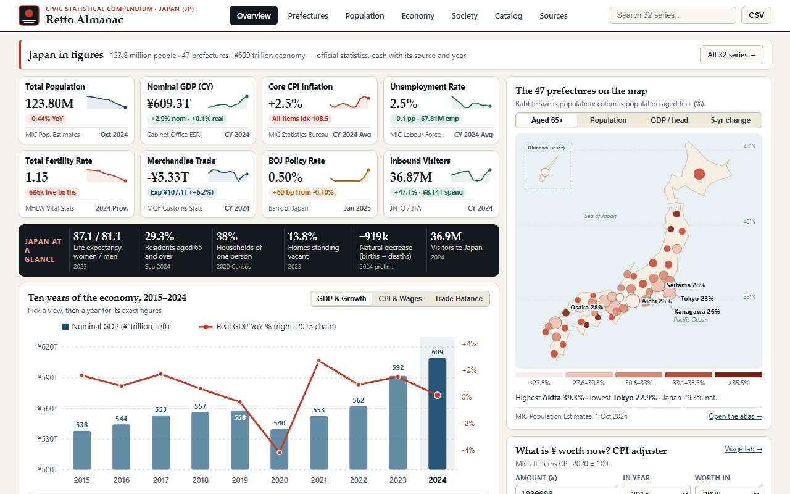

# Retto Almanac — Civic Statistical Atlas of Japan

[](https://make.fun/bounty/best-national-statistics-site-20261126-0539?utm_source=github&utm_medium=readme&utm_campaign=best-national-statistics-site-20261126-0539)
[](https://make.fun/bounty/best-national-statistics-site-20261126-0539/leaderboard?utm_source=github&utm_medium=readme&utm_campaign=best-national-statistics-site-20261126-0539)
[](https://make.fun/bounty/best-national-statistics-site-20261126-0539?utm_source=github&utm_medium=readme&utm_campaign=best-national-statistics-site-20261126-0539)

Retto Almanac is a national statistics site for Japan. It works offline and has no dependencies:
plain static files, no framework, no build step and no network requests. Every figure shows its
publishing agency and reference period. It was built for make.fun's
["Make the best national statistics site"](https://make.fun/bounty/best-national-statistics-site-20261126-0539)
bounty.



## Pages

| Page | Route | What a visitor gets |
| --- | --- | --- |
| Overview | `#/` | Eight headline indicators with 10-year sparklines, "Japan at a glance", the 2015–2024 GDP / CPI / trade chart with a year scrubber, a map of the 47 prefectures (ageing, population, GDP per head or 5-year change, with the highest and lowest named), a CPI adjuster that says whether wages kept up with prices, and the release list |
| Prefectures | `#/regions` | A geographic map of all 47 prefectures (bubbles sized by population, Okinawa inset) or an equal-tile map, five metrics, a selected-prefecture card, a three-way comparison and a sortable directory |
| Population | `#/demographics` | Age–sex pyramids (2000, 2015, 2024, 2040 projection), births vs deaths since 1990, employment and pay by industry |
| Economy | `#/economy` | CPI contributions, a household-income buying-power lab, the electricity mix and trade by partner |
| Society & Living | `#/society` | 25 figures on health, ageing, births and deaths, households, housing, safety, land and climate, filterable by theme, with a life-expectancy chart and the household mix |
| Catalog | `#/catalog` | 32 official series with search, CSV/JSON export, a citation builder and survey methods |
| Sources & Methods | `#/sources` | The publishing agencies with their release cadence, and a figure finder that traces every number on the site to its source |
| Glossary | `#/glossary` | 22 terms (core CPI, TFR, real wages, FY vs CY …) in plain language, each linked to the page that uses it |

Pages other than the Overview load on demand with `import()`, so the first load stays small.
Every page works at phone width.

The map is drawn from `app/prefecture-geo.js`: an approximate centre for each prefecture and
coastlines of the four main islands and Okinawa Island, traced by hand from headlands and ports.
It is precise enough for a statistical map a few hundred pixels wide, not for navigation, and leaves
out the smaller islands. `app/japan-map.js` projects it (longitudes scaled by the cosine of the
latitude), sizes each bubble by population and colours it by the chosen indicator's bins.

## Run it

```sh
node serve.ts --port 8080        # then open http://localhost:8080
```

## Check and hand in

```sh
node tools/check-data.mjs        # every figure has a value, a period and a source
node tools/verify-site.mjs       # all 8 routes on desktop and phone, filters, no network, screenshots
MAKEFUN_OUTPUT_DIR=out node main.ts
```

## Sources

Statistics Bureau of Japan (MIC), Cabinet Office ESRI, Ministry of Health, Labour and Welfare,
Ministry of Finance, Bank of Japan, METI / ANRE, JNTO, National Police Agency, Geospatial
Information Authority, Forestry Agency, Ministry of the Environment, Immigration Services Agency
and IPSS. Figures are the latest final or preliminary editions; preliminary figures are labelled.
